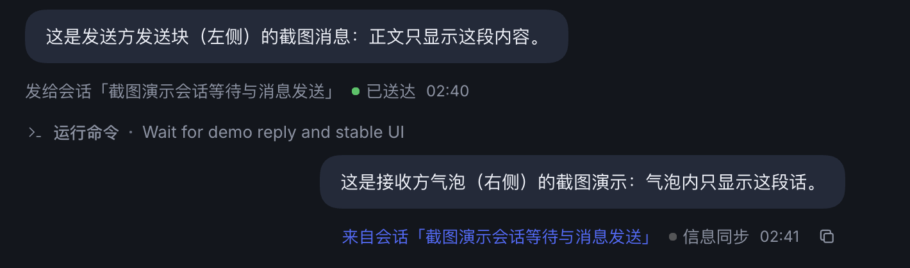
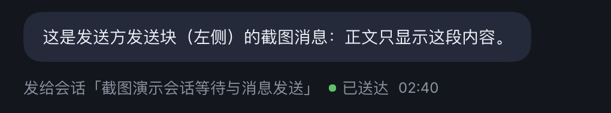
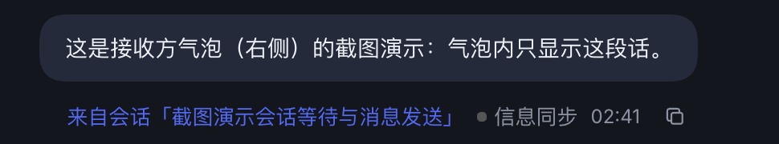
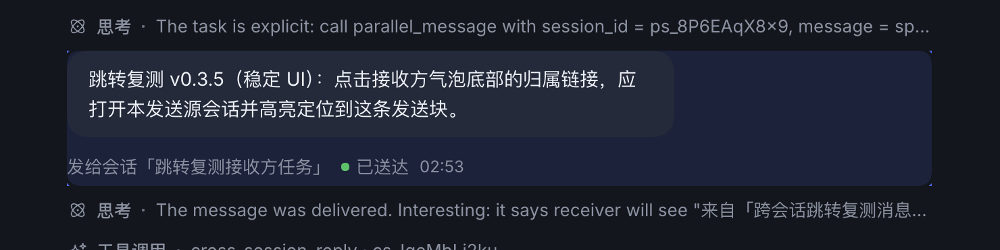

# dsh-parallel-sessions（并行会话协调）

> DeepSeek Harness 的跨会话协调插件：当同一个进程中存在并行的任务/会话时，让它们能互相沟通、一个会话引导另一个会话的设计方向；当一项任务会影响另一项任务的阶段时，暂停对方，等本任务完成后再通知对方继续。接收方会话内会显示消息由哪个会话发起。

本插件参考了两个现有插件的设计思路：

- [`dsh-cross-session-approval`](https://github.com/zsjs110110-cpu/dsh-cross-session-approval)：跨会话派活、投递原语、会话别名与注册表思路；
- [`dsh-agent-message`](https://github.com/GengDaPeng/dsh-agent-message)：把跨会话消息显示为带发送方归属的可见 Agent 消息卡片。

两者面向 DSH 0.1.x/0.2.x 早期版本；本插件按当前 **DSH 0.2.1-rc.2** 的 Host Service、Session 事件与 Chat 渲染契约重新实现，并补上了「阶段冲突时暂停/自动恢复」的协作协议。

## 能力

| 工具 | 作用 |
|---|---|
| `parallel_sessions` | 检测同一工作区内并行运行/曾运行过的顶层会话：`ps_` 别名、标题、运行状态、工作目录、暂停关系。用于发现“有并行的任务和会话”。 |
| `parallel_message` | 向另一个会话投递消息，**默认 `mode=steer` 直接送达**（运行中在下一步边界立即插入，空闲时立即开一轮），只有显式 `mode=queue` 才等对方当前整轮结束后再投递。接收方对话流内渲染为**右侧**聊天气泡（我收到的消息，正文只含消息内容，底部显示发送方/状态/时间/复制），发送方对话流内渲染为**左侧**“发给会话「…」”的发送块（我发出的消息）。`intent=guide` 表示引导对方的设计方向。 |
| `parallel_hold` | 当本任务会影响另一个会话的阶段时暂停它：真实停止其当前运行回合、清除其待处理队列（数量会上报），并投递带发送方归属的暂停通知。`until=holder-turn-end`（默认）在本轮任务结束时自动恢复对方；`until=manual` 需要显式恢复。 |
| `parallel_release` | 恢复被本会话暂停的会话，并投递带发起方归属的“继续工作”通知与变更摘要。 |

## 典型流程

1. 会话 A 在推进中发现自己的改动会影响会话 B 正在做的阶段：
   1. `parallel_sessions` → 找到 B 的 `ps_` 别名；
   2. `parallel_hold({ session_id: "ps_...", reason: "我正在重构 B 依赖的 xxx 接口", impact: "B 的联调阶段" })`；
   3. B 的运行回合被真实停止，B 的 Chat 中出现「暂停通知 · 来自「A」」卡片；B 的输入区上方显示 `已暂停 · 等待「A」完成任务`。
2. A 完成任务、本轮结束 → 插件监听 `turn/end` 自动恢复 B，B 收到「恢复通知 · 来自「A」」。
3. 如果 A 只是要沟通（不是暂停）：`parallel_message({ session_id: "ps_...", message: "...", intent: "guide" })`。

## 消息归属如何显示

每条跨会话消息都是真实的持久化 `user/message`，来源字段同时携带结构化归属：

```json
{
  "kind": "agent-message",
  "form": "relay",
  "producer": "parallel-sessions",
  "senderSessionId": "session-...",
  "senderTitle": "设计评审",
  "senderAlias": "ps_xxxxxxxxxx",
  "targetSessionId": "session-...",
  "intent": "guide",
  "summary": "把登录接口的返回结构改成统一 Result 包装"
}
```

- Chat 的内置 `relay` 渲染器据 `form: "relay"` + `senderSessionId` 显示「来自会话 …」并渲染正文；唤醒型投递则显示为“收到任务消息”的回合触发行，展开即可看到正文。
- 点击「来自会话」会打开对应会话的历史窗口并定位到那次发送调用；如果发送方会话已归档，会先自动取消归档再打开（避免跳到空白新会话）。
- 插件自带的 Client 半区把跨会话消息渲染为**对话流内的聊天气泡**（`conversation.chat.node` 自定义节点，复用宿主用户气泡的圆角/配色/字号 token），我发出的发送块靠左、我收到的接收气泡靠右。气泡内只显示消息正文（`source.display` 投影，模型可见的协调头部不会进入 UI）。底部一行依次是：**来自会话「标题」（点击打开发送方会话，并滚动/高亮到本插件渲染的发送块；优先使用发送块自身的 `data-parallel-call-id` 锚点，自动展开折叠的回合过程；若目标在未加载的历史里，会自动点击 Chat 的「加载更早」逐页向前翻找，最多 80 页）· 状态（是否继续：如“已暂停 · 等待继续”/“已恢复 · 可以继续”）· 时间 · 复制按钮**。发送方一侧通过 `tool.call.toolview` 把 `parallel_message` 的工具卡片替换为“发给会话「标题」+ 正文 + 状态”的独立发送块，不显示 messageId 等技术字段。
- 正文首行同样由 Host 写入发送方标题与 `ps_` 别名，模型不依赖 UI 也能知道“是谁发来的、该用哪个别名回信”。

## 界面截图（实际运行效果）

以下截图来自本机运行中的 DeepSeek Harness（v0.3.3，2026-10-23）。

**方向约定：我发出的发送块在左，我收到的接收气泡在右；气泡底部显示归属会话、是否继续状态、时间与复制按钮。**







点击「来自会话」跳转后，目标发送块会被高亮（实测截图，2026-10-23）：



## 安装

把本目录作为本地 bundle 安装进当前 profile：

```text
plugin_manager({ action: "install_bundle", target: "<本目录绝对路径>" })
```

安装后插件行与 Client 半区由 `dsh.bundle` / `dsh.client` 自动挂载，无需手改 `cordis.patch.yml`。工具名以 `parallel_` 开头，与 `cross_session_*` 工具可以共存。

## 配置

`cordis.patch.yml` 的插件行支持以下配置（均在代码中有默认值）：

| 键 | 默认 | 说明 |
|---|---|---|
| `guide` | `true` | 检测到并行会话时，向系统提示注入一段简短的协调指引（无并行会话时不注入，避免常驻 token）。 |
| `autoReleaseOnTurnEnd` | `true` | `holder-turn-end` 暂停在发起方回合结束时自动恢复。 |
| `holdCancel` | `true` | 暂停时真正取消目标运行中的回合（`agent.cancel({kind:'user'})`，会清空其待处理队列）。 |
| `maxHolds` | `8` | 同时存在的暂停登记上限。 |
| `pairMessageLimit` / `pairWindowMs` | `10` / `60000` | 同一对会话在滚动窗口内的投递上限，防止两个 Agent 互相刷屏。 |
| `maxTextBytes` | `32768` | 单条消息正文的 UTF-8 字节上限。 |

## 边界与已知限制

- 只协调**同一工作区**的**顶层会话**：归档会话、子代理（`origin: subagent`）与跨工作区会话会被拒绝。
- 暂停只对**已加载**（running/idle）的会话有效；offline 会话没有可停止的运行任务，可改用 `parallel_message` 留言（会自动恢复后排队投递）。
- 暂停登记保存在进程内存中：Harness 重启后不会自动恢复已暂停的会话；重启前请先 `parallel_release`。
- `agent.cancel` 的停止语义属于宿主：它停止当前回合并清空待处理队列。需要保留队列时请把 `holdCancel` 设为 `false`（此时暂停仅记录登记并发通知，等待对方自然空闲）。
- 会话 ID 可能被显示链路遮蔽；所有工具优先使用 `ps_` 别名寻址，收到遮蔽占位符会明确报错而不是猜。
- 跳转目标会话若已归档，点击时会自动执行一次「取消归档」再打开历史；不希望对归档会话做任何改变时请不要点击归属链接。
- 若目标发送块远早于当前已加载历史，插件会自动点击 Chat 的「加载更早」最多 80 页来翻找；超过该范围仍会提示未找到，可手动向上滚动后再点一次。
- 本插件不替代权限审批：暂停/恢复不需要提权，但消息投递遵守目标会话自身的权限与审批策略。

## 目录

```
dsh-parallel-sessions/
├── lib/core.js      纯函数：别名、占位符识别、文本截断、归属 source、通知文案、限流
├── lib/index.js     Host：4 个工具、投递/恢复、turn/end 自动恢复、系统提示指引
├── client.js        Client：对话内跨会话气泡（接收方）+ 发送块（发起方），底部含会话跳转/继续状态/时间/复制
├── cordis.patch.yml 自注册补丁
├── locale/*.json    插件管理器显示元数据
└── test/            node:test 单元测试（纯函数 + mock Host）
```

## 开发验证

```sh
node --test test/*.test.js
node --check lib/index.js && node --check lib/core.js && node --check client.js
```

## 验证记录（DSH 0.2.1-rc.2 / desktop profile）

- 单元测试：30 个用例全部通过（18 个 host/core + 10 个 client：在原有基础上新增「槽位回调延迟时 Definition 仍注册」与「归档发送方先取消归档再打开」回归用例）。
- 安装：v0.2.1 重新安装后 `application: applied`，profile 的 bundles 与依赖包含本插件，`parallel_*` 工具进入模型可用工具表；
  在线页面经 Cordis Inspect 确认：`conversation.chat.node` 出现 `dsh-parallel-sessions-client / parallel-session-card`（active），
  `conversation.input.dock` 中不再有本插件（固定底部条已移除）。
- 真实双会话自测：
  - 目标会话运行 `sleep 90` 时被 `parallel_hold` 暂停，宿主日志出现
    `turn/end {reason:{kind:'aborted', reason:{kind:'user'}}}`，证明是真实中止而不是只发消息；
  - 持久化 `user/message` 的 `source` 字段包含 `kind:'agent-message'`、`form:'relay'`、
    `producer:'parallel-sessions'`、`senderSessionId`、`senderTitle`、`senderAlias`、`intent`、`summary`，
    接收方 Chat 的内置 relay 渲染器据此显示「来自会话 …」；
  - 发起方会话在 `until=holder-turn-end` 暂停后结束本轮，目标会话随后自动收到
    `intent:'release'` 的「恢复通知」并继续；发起方未调用 `parallel_release`；
  - 目标会话用 `parallel_message` 回信发起方，双向沟通与归属显示均正常。
- 端到端演示：从临时会话向当前会话投递 `intent:info` 消息（默认 steer 直接送达），接收方气泡底部显示「来自会话「…」· 信息同步 · 时间 · 复制」；发送方会话内对应显示“发给会话「…」+ 正文 + 已送达”的发送块。临时会话已归档。
- v0.3 在线验证：在线页面中接收方气泡 `parallel-session-card` 与发送方发送块 `parallel_message`（`tool.call.toolview`）两个渲染器均为 active；用临时会话做了双向演示：接收方会话的对话流出现仅含正文的气泡，发送方会话的 `parallel_message` 工具卡片被替换为“发给会话「…」+ 正文 + 已送达”的发送块；临时会话已归档。
- 视觉渲染：已用真实运行界面截图验证并保存到 `docs/screenshots/`（见上方「界面截图」章节）；截图取自本机 GUI，接收气泡靠右、发送块靠左。
- 关键修复 1（v0.3.0）：Client 半区此前未在 `inject` 中声明 `uiConversation`，导致自定义 Conversation Definition 未注册、消息回退为内置渲染（头部信息外露）。已补上 `uiConversation` / `uiWorkspace` 注入。
- 关键修复 2（v0.3.3）：冷启动时 Chat 节点槽位回调可能晚于 client apply 执行，原先用该回调的同步结果决定是否注册消息 Definition，导致重启后气泡不出现；现改为独立注册 Definition，并加了回归测试。
- 关键修复 3（v0.3.4）：点击归属链接打开已归档的发送方会话会被宿主拒绝而落到空白视图；现在先自动取消归档，再打开历史。
- 关键修复 4（v0.3.5）：跳转定位原先依赖计算 Chat 工具节点的 context key，容易受节点位置/折叠/加载窗口影响；现在发送块自身带 `data-parallel-call-id` 锚点，点击后按锚点轮询定位并高亮，找不到时再回退到节点 key 扫描。
- 关键修复 6（v0.4.1）：跳转目标不在已加载历史窗口时，不再直接放弃；自动激活 Chat 自身的「加载更早」控件逐页向前加载并反复查找锚点（最多 80 页，连续 4 次无进展即停止），找到后滚动并高亮。新增 mock DOM 回归测试覆盖该翻页路径（30 个用例全部通过）。
- 关键修复 5（v0.3.8/0.3.9）：高亮改为「重新应用 data 属性 + CSS 规则」，避免历史加载触发 React 重渲染后高亮丢失；找不到目标时弹出提示；并清理旧版本遗留的调试标记。实测（macOS 屏幕录制 + CGEvent 自动点击）：点击接收方气泡的归属链接后成功打开发送方会话，锚点在第一次轮询即命中，发送块被高亮。

## 仓库

- GitHub: <https://github.com/CatLollipop/dsh-parallel-sessions>

[](https://github.com/deepseek-ai/deepseek-harness)


